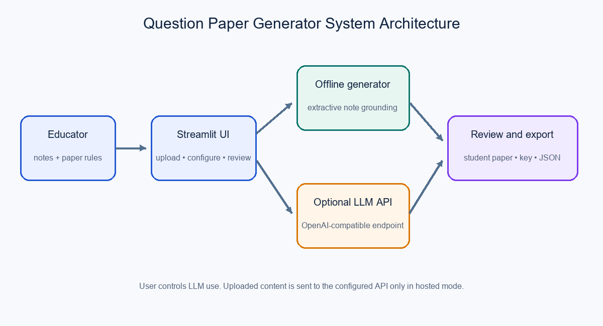
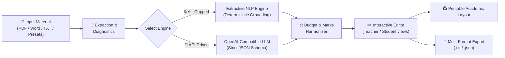

<div align="center">

# 📝 PaperForge Studio
### Intelligent Assessment & Question Paper Engineering System

[](https://www.python.org/)
[](https://streamlit.io/)
[](https://github.com/taslimzafar/Question-Paper-Generator)
[](https://github.com/taslimzafar/Question-Paper-Generator)

<p align="center">
  <strong>Transform raw syllabus notes, lecture transcripts, and textbook chapters into accredited, balanced, and editable examination papers in seconds.</strong>
</p>

[Explore Features](#-key-features) •
[Quick Start](#-quick-start) •
[Architecture](#-system-architecture) •
[Engine Comparison](#-engine-comparison-offline-vs-llm) •
[EDA & Benchmarks](#-exploratory-data-analysis-eda) •
[Project Structure](#-project-structure)

</div>

---

## 🌟 Overview

**PaperForge Studio** is a production-grade academic assessment drafting platform built with Python and Streamlit. Designed for educators, university faculty, corporate trainers, and curriculum designers, it bridges the gap between unstructured educational content and rigorous, accredited examination papers.

The platform provides a **dual-engine architecture**:
1. **100% Private Offline NLP Engine:** Operates entirely locally with zero network calls, zero API costs, and strict extractive grounding to ensure zero hallucination.
2. **OpenAI-Compatible LLM Engine:** Seamlessly connects to any state-of-the-art model provider (OpenAI, Groq, Ollama, LocalAI, vLLM) for creative distractor generation and advanced cognitive synthesis.

---

## 🏛️ System Architecture

<div align="center">
  
</div>

### 🔄 End-to-End Workflow



---

## ✨ Key Features

### 🎨 Modern SaaS Studio UI
- **Glassmorphic Hero Interface:** Real-time system diagnostics, responsive layout, and design system powered by *Plus Jakarta Sans*.
- **Live Document Diagnostics:** Instant analytics on word count, sentence count, estimated reading duration, and context completeness indicator.
- **One-Click Demo Presets:** Pre-loaded domain notes for **Operating Systems**, **Machine Learning**, and **Environmental Science** for immediate test runs without manual uploads.

### 📄 Universal Material Ingestion
- Upload native **PDF documents** (multi-page parsing via `pypdf`).
- Parse Microsoft Word **`.docx`** files (structured paragraph extraction via `python-docx`).
- Direct UTF-8 plain text upload or interactive textarea editing.

### ⚙️ Granular Assessment Blueprinting
- **Academic Profiling:** Configurable Subject, Academic Level (Undergraduate, Postgraduate, High School, Certification), and Assessment Type (Midterm, Final, Unit Test, Quiz).
- **Difficulty Grading:** Calibrated verb frameworks for *Easy* (Define, State), *Moderate* (Explain, Differentiate), and *Challenging* (Critically Analyze, Evaluate).
- **Flexible Item Distribution:** Combine Multiple Choice Questions (MCQ), Short Conceptual Answers, and Comprehensive Descriptive items.
- **Strict Marks Allocation:** Automatic mathematical distribution ensuring individual question weights sum exactly to the requested mark budget.

### 🔍 Interactive Verification & Printable Layout
- **In-Browser Question Editor:** Real-time editing of question prompts, individual mark weightings, and model answer keys.
- **Teacher Marking Scheme:** Dedicated expandable view showing canonical answers, scoring rubrics, and source context citations.
- **Printable Institutional Paper Layout:** Formal academic exam paper formatting with customizable Institution Name, Time Allowed, General Instructions, and Section Question items ready for paper distribution.

### 💾 Multi-Format Export Studio
- **Student Examination Paper (`.txt`):** Clean, un-keyed assessment ready for student distribution.
- **Teacher Answer Key (`.txt`):** Complete marking guide with model answers, rubrics, and source citations.
- **Full Schema (`.json`):** Machine-readable export for integration into Learning Management Systems (Canvas, Moodle, Blackboard).

---

## ⚖️ Engine Comparison: Offline vs. LLM

| Feature | 🔒 Offline Extractive NLP | 🤖 OpenAI-Compatible LLM |
|---|---|---|
| **Network Access** | **100% Air-Gapped** (No internet required) | Internet connection required |
| **API Key / Account** | **None** (Zero setup cost) | User-provided OpenAI, Groq, or Ollama key |
| **Data Privacy** | All notes remain strictly in host memory | Data transmitted to chosen provider |
| **Latency** | **< 0.05 seconds** (Instantaneous) | 2–6 seconds (Provider dependent) |
| **Factual Hallucination** | **0%** (Strictly extractive citations) | Minimal (Controlled by strict system prompt) |
| **Distractor Generation** | Derived from cross-sentence concepts | Contextually synthesized alternatives |
| **Compute Target** | Runs seamlessly on low-power CPUs | Executed remotely or via local GPU/vLLM |

---

## 🚀 Quick Start

### Prerequisites
- **Python 3.10+** installed and added to system `PATH`.
- **Git** installed.

---

### Method 1: One-Click Automated Launchers

#### 🪟 Windows (Batch script)
Simply double-click `run_windows.bat` or execute in PowerShell:
```powershell
.\run_windows.bat
```
*The script automatically creates `.venv`, installs/updates dependencies, and starts the web application.*

#### 🐧 Linux / 🍎 macOS (Shell script)
```bash
chmod +x run_unix.sh
./run_unix.sh
```

---

### Method 2: Manual Terminal Setup

1. **Clone the Repository:**
   ```bash
   git clone https://github.com/taslimzafar/Question-Paper-Generator.git
   cd Question-Paper-Generator
   ```

2. **Initialize Virtual Environment:**
   - **Windows:**
     ```powershell
     python -m venv .venv
     .\.venv\Scripts\activate
     ```
   - **Linux / macOS:**
     ```bash
     python3 -m venv .venv
     source .venv/bin/activate
     ```

3. **Install Dependencies:**
   ```bash
   pip install --upgrade pip
   pip install -r requirements.txt
   ```

4. **Run the Streamlit Application:**
   ```bash
   streamlit run app.py
   ```
   Open your browser at: **`http://localhost:8501`**

---

## 📁 Project Structure

```text
Question-Paper-Generator/
├── app.py                             # Core Streamlit web application & generation pipeline
├── requirements.txt                   # Production Python package dependencies
├── run_windows.bat                    # One-click Windows setup & launcher
├── run_unix.sh                        # One-click Linux/macOS setup & launcher
├── .gitignore                         # Version control ignore rules (venv, cache, secrets)
├── README.md                          # Comprehensive project documentation
│
├── analysis/                          # Exploratory Data Analysis & visual benchmarks
│   ├── eda.py                         # Reproducible data cleaning & visualization pipeline
│   ├── eda_summary.json               # Computed summary statistics of reference metadata
│   ├── query_type_counts.svg          # Query intent category distribution chart
│   ├── retrieval_score_distribution.svg # Relevance score histogram chart
│   └── word_count_vs_quality.svg      # Word count vs synthetic quality scatter chart
│
├── data/                              # Metadata reference corpus & data dictionaries
│   ├── dataset.csv                    # Cleaned reference dataset (500 records)
│   ├── dataset_original.csv           # Raw source reference dataset
│   ├── data_dictionary.csv            # Formal field definitions, types & constraints
│   └── data_dictionary_original.csv   # Original schema definition
│
└── docs/                              # Academic reports, architecture & ethical guidelines
    ├── architecture.png               # High-resolution system architecture diagram
    ├── architecture.svg               # Vector source of architecture diagram
    ├── Ethical_Compliance_Checklist.md# Ethics, privacy & fairness compliance checklist
    ├── Project_Report.md              # Academic technical report
    ├── Project_Report.docx            # Formatted Word document of project report
    ├── Project_Synopsis_Completed.md  # Formal project synopsis & scope definition
    ├── Project_Synopsis_Completed.docx# Word document format of project synopsis
    └── Project_Synopsis_Template.docx # Academic synopsis template
```

---

## 📊 Exploratory Data Analysis (EDA)

The project includes an integrated exploratory data analysis suite evaluating a 500-row synthetic retrieval metadata corpus:

| Metric | Corpus Statistic |
|---|---|
| **Total Chunks** | 500 Records |
| **Mean Retrieval Score** | 0.7466 |
| **Mean Answer Quality Score** | 0.8029 (Range: 0.600 – 1.000) |
| **Query Intent Categories** | Summarization (118), Procedural (106), Factual (94), Comparative (92), Analytical (90) |
| **Duplicates / Missing Values** | 0 |

### Generated Visualizations
- **Query Type Distribution:** `analysis/query_type_counts.svg`
- **Retrieval Score Distribution:** `analysis/retrieval_score_distribution.svg`
- **Chunk Word Count vs Quality Score:** `analysis/word_count_vs_quality.svg`

To re-execute data cleaning and rebuild the vector charts:
```bash
python analysis/eda.py
```

---

## 🛡️ Responsible AI, Ethics & Compliance

- **Human-in-the-Loop Imperative:** AI-generated assessments serve as an editorial drafting aid. All items, scoring rubrics, and answer keys must be reviewed and certified by an accredited educator before formal administration.
- **Privacy & Data Security:**
  - In **Offline Mode**, all computations occur locally on the host CPU. No documents or prompts ever leave your machine.
  - In **LLM Mode**, data is sent exclusively to the user's explicitly configured API endpoint.
  - **No Credential Persistence:** API keys are held strictly in temporary session memory and are never written to disk, databases, or log files.
- **Fairness & Accessibility:** Educators are prompted to review generated questions for clarity, unbiased language, and accessibility accommodations.

---

## 🤝 Contributing

Contributions, feature suggestions, and bug reports are warmly welcome!
1. Fork the repository.
2. Create your feature branch (`git checkout -b feature/AmazingFeature`).
3. Commit your changes (`git commit -m 'Add some AmazingFeature'`).
4. Push to the branch (`git push origin feature/AmazingFeature`).
5. Open a Pull Request.

---

## 👤 Author

**MD Taslim**  
- GitHub: [@taslimzafar](https://github.com/taslimzafar)
- Project Repository: [Question-Paper-Generator](https://github.com/taslimzafar/Question-Paper-Generator)

---

<div align="center">
  <sub>Built with ❤️ for educators, universities, and pedagogical institutions.</sub>
</div>
